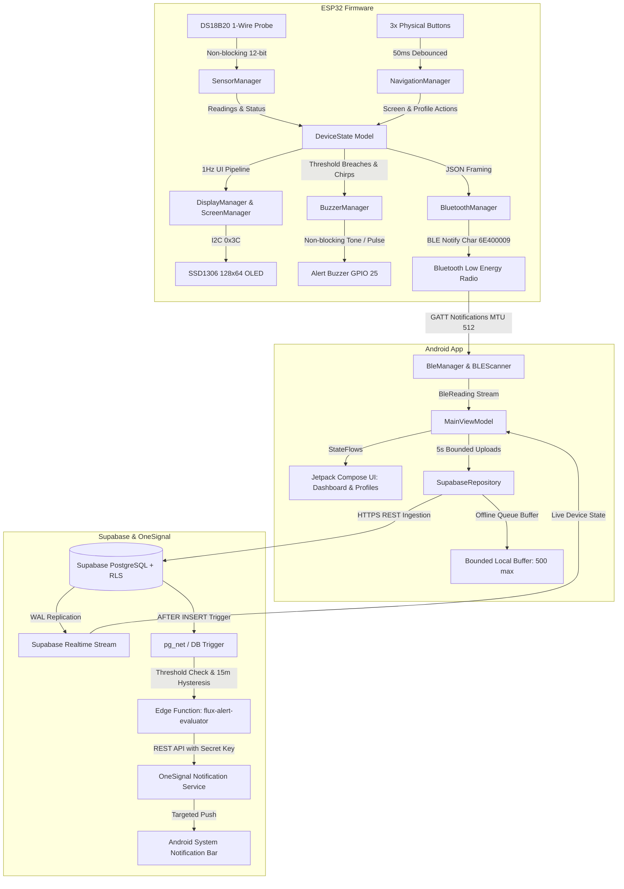
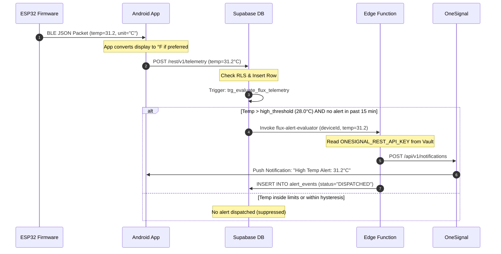

# Flux — System Architecture & Data Flow

## 1. High-Level System Architecture

**Flux — Smart Telemetry System** is organized into three distinct tiers:
1. **Edge Tier (ESP32 Microcontroller):** Autonomous, non-blocking digital temperature acquisition, local OLED rendering, physical button navigation, session analytics, and BLE GATT streaming.
2. **Mobile Tier (Android Companion App):** Offline-first telemetry hub, Jetpack Compose dashboard, BLE client, unit converter, local buffer queue, and Supabase / OneSignal coordinator.
3. **Cloud Tier (Supabase & OneSignal):** Relational time-series persistence, Row Level Security, Realtime logical replication, automated alert evaluation, and push notification delivery.

---

## 2. Firmware Modular Design

The ESP32 firmware cleanly divides responsibilities to ensure the local display, sensor loop, and acoustic alerts remain responsive even when BLE or network operations are executing:

- **`SensorManager`:**
  - Manages Dallas `OneWire` bus on GPIO 4.
  - Implements asynchronous, non-blocking 12-bit conversion.
  - Automatically identifies sensor disconnections (`-127.0°C`).
  - Maintains monotonic session statistics: Minimum, Maximum, Cumulative Average, and Sample Count.
- **`DisplayManager` & `ScreenManager`:**
  - Drives SSD1306 OLED via hardware I2C (GPIO 21 SDA, GPIO 22 SCL).
  - Coordinates an 8-screen carousel: Dashboard, Live Monitor, Environment, Liquid Probe, Fermentation, Stats & Timer, System Status, and Settings.
  - Employs dirty-flag change detection to eliminate screen flicker and avoid unnecessary I2C bus traffic.
- **`BuzzerManager`:**
  - Drives physical alert buzzer on GPIO 25.
  - 100% non-blocking cooperative state machine driven by `millis()` deltas (zero `delay()` calls).
  - Generates ascending boot chime (`2700 Hz -> 3300 Hz`) on power-up to confirm wiring.
  - Sounds repeating dual-tone alarm burst (`140ms @ 2400 Hz -> 80ms rest -> 140ms @ 2600 Hz -> 1200ms rest`) during temperature threshold breaches.
  - Generates single tactile feedback pip (`3000 Hz` for 45ms) when enabled.
  - Instant mute on setting disable or when temperature returns to safe limits.
  - Universal hardware support for active buzzers (`digitalWrite`) and passive piezo transducers (`tone()`).
- **`NavigationManager` & `ButtonDebouncer`:**
  - Debounces 3 physical buttons on GPIO 16, 17, and 18 with 50ms transition filtering.
  - Maps short-press navigation and action triggers.
  - Implements long-press detection (> 1.2s on Select) to return to Dashboard from any menu level.
- **`BluetoothManager`:**
  - Configures BLE GATT Server advertising as `"Flux1"`.
  - Negotiates 512-byte MTU for single-packet JSON transmission.
  - Streams 1.0 Hz telemetry including temperature, session stats, alert flags, and buzzer state (`"buzzer": true/false`).
  - Listens for command writes on characteristic `6E400002` (unit changes, profile mode toggles, session resets, and buzzer toggles `SET_BUZZER:1`/`0`).

---

## 3. Android Companion Architecture

Built according to modern Android architectural guidelines:

- **UI Layer (Jetpack Compose):**
  - Declarative, themeable dark-mode UI with high-contrast accents (`#020617` background, `#A3E635` lime green, `#38BDF8` sky blue).
  - Dedicated screens for each monitoring profile (Environment, Liquid Probe, Fermentation).
  - Real-time Bézier curve temperature trend graph with dynamic axis scaling.
  - Delivery Channels configuration in `FluxAlertSettingsScreen` featuring physical ESP32 Hardware Buzzer (GPIO 25) control alongside OneSignal push toggles.
- **Presentation Layer (`MainViewModel`):**
  - Manages reactive UI state using Kotlin `StateFlow` and `SharedFlow`.
  - Coordinates BLE telemetry ingestion, user preference persistence, and Supabase cloud synchronization.
  - Exposes clean methods for unit toggle, profile activation, threshold tuning, and buzzer enable/disable (`setBuzzerEnabled`).
- **Data Layer:**
  - **`BleManager`:** Asynchronous BLE connection lifecycle, auto-reconnect logic, characteristic subscription, and command transmitter (`setBuzzerEnabled`).
  - **`SettingsRepository`:** Local preference storage using Jetpack DataStore / SharedPreferences.
  - **`SupabaseRepository`:** Manages cloud telemetry uploads at a configurable rate (default 5.0s), with an integrated bounded in-memory and SQLite offline queue (500 records max) that auto-flushes on network restoration.
  - **`OneSignalManager`:** Push notification registration, user ID tagging, and click-intent routing.

---

## 4. Cloud Data Flow & Security Boundaries

### Security Isolation
- **Anonymous Keys Only on Client:** The mobile app holds only the public Supabase `anon` key.
- **Restricted Telemetry Access:** Row Level Security (RLS) ensures users can query only their own devices and readings.
- **Protected Service Credentials:** The OneSignal REST API Key and Supabase `service_role` key exist solely in Supabase Edge Function environment secrets.
